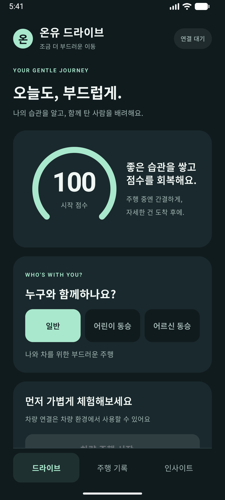
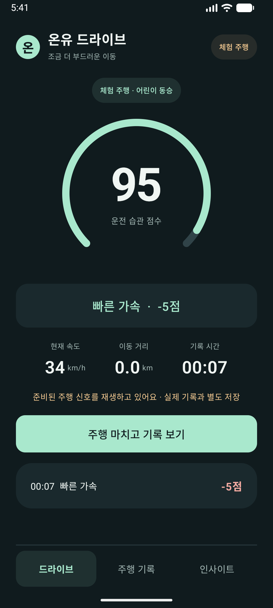
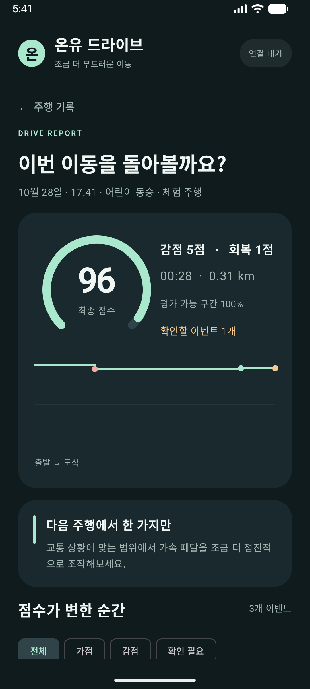
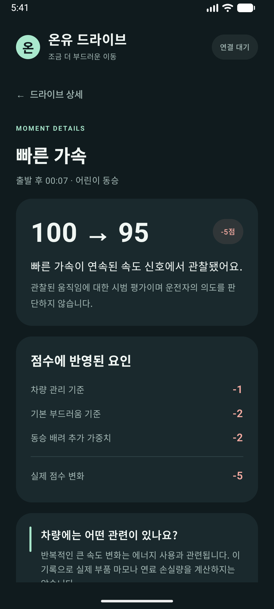

# 온유 드라이브 — 구현 작업 보고서

작업일: 2026-10-28 · 기준 기획: `service-plan.md` v0.2

## 1. 이번에 만든 결과

기본 문구만 표시하던 Android 프로젝트를 **운전 습관을 기록하고, 주행 후 점수 변화의 이유를 돌아보는 차량용 MVP**로 구현했습니다. 앱 이름은 임시로 **온유 드라이브**로 정했습니다.

화면만 있는 시안이 아니라, 주행 신호 입력 → 행동 감지 → 점수 계산 → 이벤트 저장 → 드라이브 상세 조회까지 연결했습니다. 서버 없이 기기 안에서 동작합니다.

## 2. 사용할 수 있는 기능

| 영역 | 구현 내용 |
|---|---|
| 시작 화면 | 일반·어린이 동승·어르신 동승 모드, 차량 연결 상태, 최근 기록 |
| 차량 주행 | AAOS 속도·기어 신호와 Pleos 브레이크·앞바퀴 각도 신호를 읽는 연결부 |
| 체험 주행 | 약 72초의 준비된 신호로 가감점과 리포트를 체험. 실제 차량 기록과 별도 표시·집계 |
| 실시간 점수 | 100점 시작, 0~100점 유지, 빠른 가속 감점, 부드러운 주행·정차 가점 |
| 조용한 안내 | 이벤트가 발생하면 화면의 고정 영역에 약 4초 동안 짧게 표시. 소리·진동 없음 |
| 드라이브 목록 | 날짜·동승 모드·시간·거리·최종 점수·확인할 이벤트 표시, 기록 출처 필터 |
| 드라이브 상세 | 점수 변화 그래프, 가점·감점 합계, 평가 가능 비율, 이벤트 타임라인·필터 |
| 이벤트 상세 | 차량 관리 기준·기본 부드러움·동승 모드 가중치·실제 변화량을 나누어 설명 |
| 감속 상황 검토 | 강한 감속은 우선 보류. 주차 후 평소 주행으로 반영하거나 위험 회피로 제외하면 이후 점수도 재계산 |
| 습관 돌아보기 | 같은 출처·동승 모드에서 두 번 이상의 드라이브에 나타난 행동 안내, 거리당 빈도 참고 |
| 체감 피드백 | 편안함 3단계 선택, 동승자 본인 응답과 운전자 관찰을 구분 |
| 기록 관리 | 개별·전체 삭제, 사용자가 고른 위치로 JSON 내보내기 |
| 중단 복구 | 주기적으로 임시 저장. 앱이 종료되면 다음 실행 시 마지막 저장 지점까지 중단 기록으로 복구 |

운전 중에는 점수와 짧은 안내만 보입니다. 차량이 P 상태이고 시스템이 조작을 허용할 때만 기록 조회·설정·상세 검토를 할 수 있습니다. 차량 상태나 시스템 제한 상태가 확인되지 않으면 상세 조작을 잠급니다. 체험 주행 중 실제 차량의 주행 상태가 바뀌면 체험을 종료합니다.

## 3. 점수 기준

아래 수치는 **시연과 초기 검증을 위한 임시 기준**입니다. 차종·도로·센서 특성에 대한 실측 검증을 마친 기준이 아닙니다.

| 감지 행동 | 차량 기준 | 동승 배려 기준 | 처리 |
|---|---:|---:|---|
| 빠른 가속 | -1 | 일반 -2 / 어린이·어르신 -4 | 관찰 시 반영 |
| 강한 감속 | -2 | 일반 -2 / 어린이·어르신 -4 | 원인 확인 전 보류 |
| 부드러운 주행 | 0 | +1 | 조건 유지 시 가점 |
| 완만한 정차 | 0 | +1 | 조건 충족 시 가점 |
| 정차 중 큰 앞바퀴 각도 변화 | 0 | 0 | 참고 기록 |
| 신호 누락 구간 | 0 | 0 | 평가 제외 |

- 어린이·어르신 모드에서는 부드러움 관련 감점만 두 배로 적용합니다. 차량 기준은 동일합니다.
- 점수가 회복되어도 앞서 발생한 이벤트는 남습니다. 100점을 넘는 가점은 미래 감점에 사용할 수 없습니다.
- 빠른 가속은 추정 가속도 +2.5m/s² 이상, 강한 감속은 -2.8m/s² 이하가 필터링 후 약 0.6초 이상 이어질 때 후보로 기록합니다. 이벤트 사이에는 중복 방지 간격을 둡니다.
- 부드러운 주행은 3m/s 이상에서 작은 속도 변화가 약 15초 이어지는 경우입니다. 반복 보상 간격과 주행당 최대 보상 횟수를 제한했습니다.
- 속도 신호의 시간 간격·유효 범위를 확인하고, 누락·역순·비정상 입력을 걸러냅니다. 평가하지 못한 시간은 평가 가능 비율에 반영합니다.
- 차량 속도로 계산한 가속도는 센서로 직접 측정한 차체 가속도나 저크와 다릅니다.

## 4. 차량 관리 설명을 다룬 방식

습관과 차량 관리의 관계를 교육용 문장으로 설명합니다. 실제 패드 수명, 타이어 마모율, 연료 손실량, 의학적인 편안함 비율은 계산하지 않습니다.

특히 속도 감소만으로 마찰제동과 회생제동의 비율을 알 수 없으므로 강한 감속을 곧바로 브레이크 마모로 판정하지 않습니다. 정차 중 조향도 주차 안전과 차량 특성이 중요하므로 참고 기록으로만 남깁니다. 필요한 긴급제동을 피하도록 유도하지 않습니다.

## 5. 데이터와 저장

- 최근 **30일, 최대 100개** 드라이브를 앱 전용 공간에 보관합니다. 최대 4시간 기록 후 중단 상태로 저장합니다.
- 저장 정보: 주행 시각·시간·거리, 동승 모드, 기록 출처, 이벤트별 점수와 검토 상태, 평가 기준 버전, 약 1초 간격의 속도·추정 가속도·가용 보조 신호(브레이크·앞바퀴 각도는 마지막 수신 값), 선택한 체감 피드백.
- GPS 좌표, 이름, 계정, 음성·영상은 수집하지 않습니다. 차량 속도 권한은 차량 OS에서 위치 정보 권한 그룹으로 표시될 수 있습니다.
- 원격 서버로 전송하지 않습니다. 기록 내보내기는 사용자가 선택한 파일에만 수행합니다.
- 화면이 다른 앱으로 넘어가도 사용자가 시작한 기록은 포그라운드 서비스로 이어집니다. 시스템이 프로세스를 종료한 뒤에는 자동으로 기록을 재개하지 않습니다.
- 저장 실패는 안내하고, 읽을 수 없는 기록은 원본을 별도 보관합니다. 삭제와 내보내기는 주차 상태에서만 가능합니다.

## 6. Pleos 및 Android 연결 작업

- 기존 Kotlin·Jetpack Compose 프로젝트를 유지했습니다.
- `android.car` 라이브러리를 연결했습니다.
- Pleos Vehicle SDK **2.3.2**와 기존 공식 Maven 저장소를 사용합니다.
- 속도·기어는 Android Automotive `CarPropertyManager`로 읽고, 브레이크·앞바퀴 각도는 Pleos SDK에서 읽습니다.
- Pleos 보조 신호는 capability를 확인한 후 구독합니다. 차량 제어·설정 변경 API는 사용하지 않습니다.
- 차량의 `CarUxRestrictionsManager` 상태와 기어를 함께 확인합니다.
- 일반 안드로이드 에뮬레이터에서는 차량 연결 없이 체험 기능을 사용할 수 있습니다.
- 최신 API 37 화면 테스트와 충돌하던 기존 Espresso를 3.7.0, AndroidX JUnit을 1.3.0으로 업데이트했습니다.
- Pleos AVD는 메모리 8GB, CPU 4코어를 사용합니다. CPU 8코어와 하드웨어 그래픽도 시험했지만 부팅을 확인하지 못해 이전 방식으로 복원했습니다. 소프트웨어 그래픽을 사용합니다. 기본 시스템 서비스의 재시작·화면 시작 지연은 남아 있습니다.

## 7. 검증 결과

| 검증 | 결과 |
|---|---|
| 디버그 APK 빌드 | 성공 |
| 점수·감지 로직 단위 테스트 | 14개 통과(기본 예제 1개 포함) |
| 기록 저장·복원·삭제·보관 기간 | Android 및 Pleos에서 각 4개 통과 |
| 실제 화면 흐름 | Android API 37에서 통과: 어린이 모드 → 가감점 → 백그라운드 기록 → 종료 → 리포트 → 이벤트 상세 → 감속 평가 제외 |
| 상세 조작 제한 조건 | Android 및 Pleos에서 통과: P·속도·UX 제한·연결 상태별 허용/차단 |
| Pleos 차량 신호 연결 | API 34 Pleos 이미지에서 통과: AAOS 연결·기어·속도·UX 상태, Pleos 브레이크·앞바퀴 각도 |
| Android 정적 검사(Lint) | 오류 0개. 기본 템플릿 리소스·의존성 업데이트 권고 등의 경고는 남아 있음 |

일반 Android에서는 Pleos 전용 신호 테스트를 의도적으로 건너뛰며, 해당 테스트는 Pleos에서 별도로 통과했습니다. Pleos에서 차량 신호를 읽을 수 있다는 확인과 실차에서 변화하는 주행 신호를 장시간 검증했다는 주장은 구분합니다. 공식 Virtual Console 화면도 열었지만 현재 Intel Mac 환경에서는 `DDS OFFLINE`, 신호 출처 `default`, 차량 브리지 미준비 상태였습니다. 따라서 위 신호 읽기 통과는 정차 상태의 기본값 접근 확인이며 가변 주행 신호 연동 성공을 의미하지 않습니다.

Pleos 전체 연속 테스트는 앱 프로세스 시작 단계에서 ANR로 중단됐습니다. 같은 로그에서 CPU 사용률 99%와 기본 시스템 앱·차량 서비스의 반복 오류가 확인됐습니다. 앱의 동기식 차량 조회·연결 해제는 별도 작업 스레드로 옮겨 느린 서비스 응답이 화면을 막지 않도록 보완했습니다. 이 환경에서의 전체 시나리오 통과는 아직 확인하지 못했습니다. 일반 Android에서의 체험·저장·리포트는 정상 검증했습니다.

제조사 안내의 Mac 이미지는 ARM64, Intel 이미지는 Windows/Linux 대상으로 구분되어 있습니다. 현재 Intel Mac에서의 부팅·기본값 읽기 확인을 공식 지원이나 전체 호환 보증으로 해석하면 안 됩니다. 실제 Pleos 시연 전에는 지원 환경에서 Virtual Console의 DDS 연결과 움직이는 차량 신호를 다시 확인해야 합니다.

원본 검증 결과: [검증 요약](verification/results.json), [일반 Android 테스트](verification/phone-final-tests.txt), [Pleos 신호 테스트](verification/pleos-signals-result.txt), [Pleos 중단 로그](verification/pleos-startup-anr.txt), [실제 프로젝트 빌드](verification/actual-project-build.txt).

체험 결과 캡처:

| 홈 | 주행 중 |
|---|---|
|  |  |

| 드라이브 리포트 | 이벤트 상세 |
|---|---|
|  |  |

캡처는 실제 앱에서 체험 신호로 만든 화면이며 실제 차량 운전 결과가 아닙니다.

빌드 산출물: [디버그 APK](../app/build/outputs/apk/debug/app-debug.apk). 개발·시연용이며 배포 서명본이 아닙니다.

## 8. 실행해서 확인하는 순서

1. Android Studio에서 **`/Users/pdj.p/Desktop/hyundai_hackathon`** 프로젝트를 엽니다.
2. Gradle 동기화 후 `app` 실행 대상을 선택합니다.
3. 빠른 확인은 일반 Android 에뮬레이터에서 앱 실행 → 동승 모드 선택 → **체험 주행 · 약 1분** 순서입니다.
4. 종료 후 **주행 기록 → 해당 드라이브 → 이벤트**에서 점수의 증감 요인과 조언을 확인합니다.
5. Pleos에서는 P 상태에서 속도 읽기 권한을 허용한 후 차량 연결 상태를 확인합니다. 차량 연결·P 상태·시스템 사용 허용 상태와 속도 값이 확인되어야 차량 주행 시작 버튼이 활성화됩니다. 정차 중 캐시된 0km/h만 있는 경우에도 기록을 시작할 수 있고, 출발 후 새로 들어오는 유효 신호만 평가합니다.
6. 차량 신호 변경 검증은 공식 Virtual Console 또는 지원되는 차량 테스트 환경이 필요합니다. 체험 신호와 실제 차량 신호는 구분됩니다.

## 9. FSD·자동주행 확장 방향

향후 자동주행에도 같은 평가 구조를 적용할 수 있도록 주행 신호, 이벤트 시각, 동승 모드, 평가 기준 버전, 체감 피드백을 나누어 기록했습니다. 현재 운전 주체는 체험 또는 미확인으로 표시하며, 실제 사람·AI 운전 여부를 자동 판별하지 않습니다.

다음 단계의 핵심은 **어떤 가감속 패턴에서 누가 편안함·불편함을 보고했는지**를 연결하는 것입니다. 사람 운전과 AI 운전의 기록을 주행 조건별로 비교하고, 동승자가 직접 남긴 피드백을 기준으로 승차감 평가를 검증하면 더 편안한 자동주행 프로파일을 연구할 수 있습니다.

현재 저장하는 약 1초 간격의 요약 신호만으로 자동주행 학습에 충분하다고 가정하지 않습니다. 실제 승차감 연구에는 더 높은 주기의 차체 움직임 신호, 주행 상황 라벨, 시간 동기화와 별도 검증이 추가로 필요합니다.

이번 버전은 FSD에 연결하거나 차량 주행을 제어하지 않습니다. 데이터가 쌓였다는 이유만으로 실제 편안함을 학습했다고 표현하지 않습니다. 향후 연구용 수집·서버 전송을 추가할 때는 별도 동의와 데이터 관리 설계를 먼저 해야 합니다.

## 10. 아직 구현하지 않은 범위

- 제한속도 구역·방지턱 자동 인식: 지도·도로 정보와 검증된 차량 신호가 추가로 필요합니다.
- 코너링·급차선 변경 분석: 횡가속도와 차량 자세 등 현재 입력만으로 충분하지 않은 정보가 필요합니다.
- 실제 부품 상태·수명 진단, 실제 승차감 백분율.
- 계정·서버·차량 간 동기화, AI 모델 학습·추천, FSD 직접 연동.
- 실차 주행에서의 기준 보정, 장시간 차량 신호 안정성 검증, 공모전 제출·배포 심사.

## 11. 나중에 코드 볼 때 찾을 위치

| 파일 | 맡은 일 |
|---|---|
| `app/src/main/java/com/example/hyundai_hackathon/MainActivity.kt` | 앱 시작, 권한 요청, 기록 파일 내보내기 |
| `.../ui/CoachApp.kt` | 홈·주행·목록·리포트·상세·인사이트 화면 |
| `.../domain/DriveModels.kt` | 주행·이벤트·모드와 점수 재계산 규칙 |
| `.../domain/DriveEngine.kt` | 차량 신호를 행동 이벤트로 바꾸는 분석기, 체험 경로 |
| `.../vehicle/CarBridge.kt` | AAOS·Pleos 신호와 차량 사용 제한 연결 |
| `.../CoachRuntime.kt` | 기록 세션·화면 상태·분석·저장을 연결 |
| `.../DriveRecordingService.kt` | 앱을 벗어나도 사용자가 시작한 주행 기록 유지 |
| `.../data/DriveStore.kt` | 기기 저장·중단 복구·삭제·JSON 변환 |
| `app/src/test/` | 점수·감지 로직 검증 |
| `app/src/androidTest/` | 저장·화면 흐름·차량 연결 검증 |

## 12. 확인한 공식 문서

- [Pleos 에뮬레이터 설치 및 호스트별 이미지 안내](https://document.pleos.ai/en/docs/connect/guide/getting-started/application-development/setup-connect-sdk-emulator)
- [Pleos Virtual Console 설정](https://document.pleos.ai/en/docs/connect/guide/getting-started/application-development/use-vehicle-emulator)

- [Pleos Vehicle SDK 프로젝트 설정](https://document.pleos.ai/docs/pleos-only/connect-sdk-pleos/Vehicle/project-setup)
- [Pleos 주행 제한 개발 가이드](https://document.pleos.ai/en/docs/pleos-only/vehicle-app-developer-guide/driving-restriction-development-guide)
- [Pleos 차량 앱 FAQ](https://document.pleos.ai/en/docs/pleos-only/vehicle-app-developer-guide/vehicle-app-faq)
- [AndroidX Test 릴리스 노트](https://developer.android.com/jetpack/androidx/releases/test)
